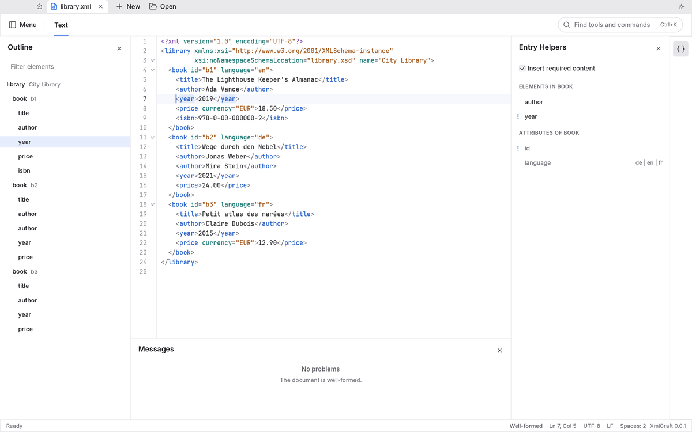
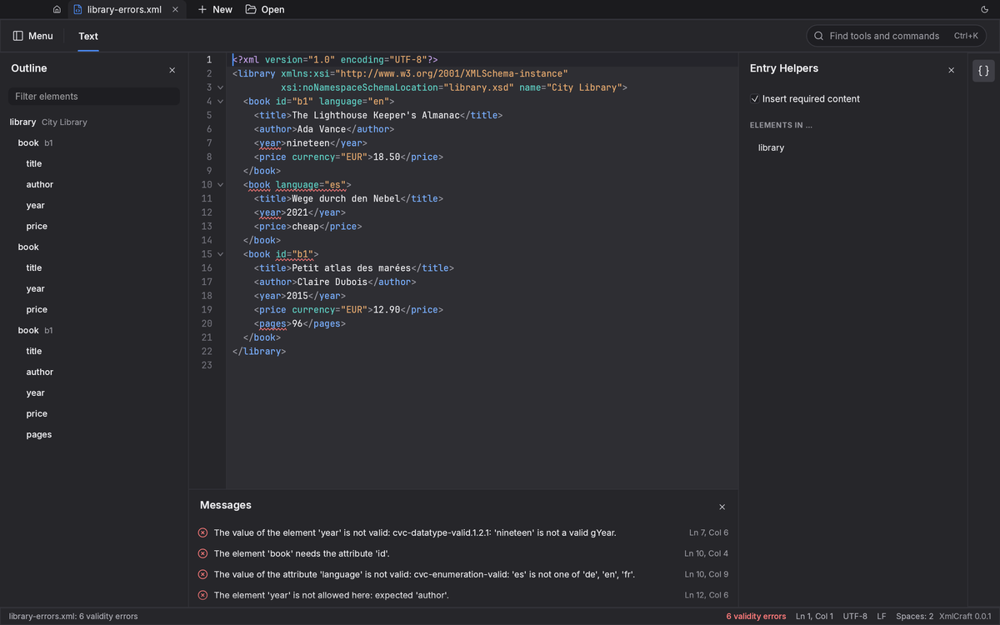
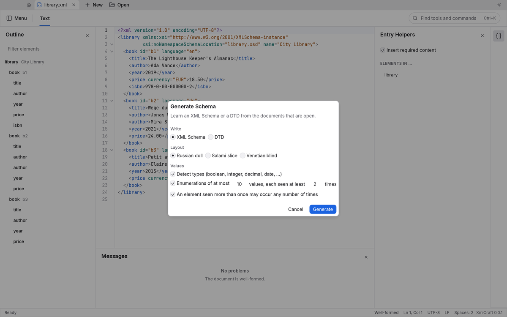

# XmlCraft

An open-source, clean-room XML editor in the spirit of Altova XMLSpy, written in Rust.

> **Status: 0.1.0, the first release, is prepared and not published yet.** The editor, the XSD and DTD engines, validation and the schema and sample generators work and are tested; there is **nothing to download yet**. Build it from source to try it. What is done and what is not is kept honestly in [ROADMAP.md](ROADMAP.md), [docs/gaps.md](docs/gaps.md) and [docs/target-app-parity.md](docs/target-app-parity.md).

## What it does today

- **Editing.** XML with syntax colouring, auto-indentation and typing aids (paired quotes and tags, tag-name sync), folding, multi-cursor and column selection, find and replace (literal and regular expressions), pretty-print and minify as minimal edits. A document is its text: opening a file and saving it without edits writes the same bytes (encoding, BOM, line endings and all), and it works on documents that are not well-formed.
- **DTD and XML Schema (XSD 1.0).** Validation (F8, and in the background while you type) against the DTD of the DOCTYPE or the schema the document names with `xsi:schemaLocation`; the problems are underlined and listed. The W3C XML conformance suite passes in full (xmlconf: 100%), and the XML Schema Test Suite at 98.2% (38,438 accepted tests, the known failures are listed).
- **Entry Helpers.** What the DTD or the schema allows at the cursor: the elements (the required ones marked), the attributes with the values their types list, the entities; a double click writes an element with what it requires. An XSD file is helped from the schema for schemas that ships with the app.
- **Schemas and samples.** Assign a schema or a DTD to a document (one undoable edit), generate an XSD (three layouts) or a DTD from documents, generate a sample document from an XSD or a DTD, start from a template.
- **Standard schemas ship with the app** (a hundred W3C files so far: XML Schema, XHTML 1.0 and 1.1, SVG 1.1, MathML 3, XLink, XML Signature, SOAP 1.2, WSDL 2.0, `xml.xsd`, …), found by their public identifier, address or namespace, so an XHTML page or an SVG drawing validates offline. Any other schema or DTD that a document names (a `schemaLocation`, a system identifier) and that is not an open document, in your catalogs or a file is **downloaded**, over https where the server has it, and kept on disk for 30 days before the server is asked whether it changed. Only addresses on the internet are asked: never this computer or your own network (`XMLCRAFT_ALLOW_PRIVATE_HOSTS=1` allows an intranet's schema server), and a namespace is a name that is never fetched. **XML ▸ Work Offline** (or `XMLCRAFT_OFFLINE=1`, or `--offline` for `xmlcraft-cli`) stops all of it and uses the copies kept. There is no telemetry; more bundled sets (the OASIS ones among them) are on the roadmap.
- **Headless.** Everything above is also a tool for scripts and agents: `xmlcraft-cli` (`check`, `validate`, `infer`, `sample`, `format`, `run <tool>`), an opt-in MCP server and an opt-in control channel for the window. `xmlcraft-cli tools` lists the tools.

Not there yet: JSON and YAML (validated with JSON Schema) are planned right after 0.1.0; XPath, XQuery and XSLT, a grid view and a graphical schema editor are further out.

## A look



*Entry Helpers offer what the schema allows at the caret: the elements (the required ones marked) and the attributes with the values their types list.*



*F8 checks the document against the schema it names; the problems are underlined in the text and listed in Messages.*



*Generate an XML Schema (three layouts) or a DTD from the open documents.* The pictures are of the real window, drawn from synthetic documents ([how](docs/screenshots/README.md)).

## Try it

You need a recent stable Rust toolchain.

```sh
cargo run -p xmlcraft -- some.xml        # the desktop app
cargo run -p xmlcraft-cli -- validate some.xml --json
cargo run -p xmlcraft-cli -- tools
```

## Platforms

Windows (x64, arm64), macOS (Intel and Apple Silicon, one universal build) and Linux (x64, arm64). The release pipeline builds all six; see [docs/releasing.md](docs/releasing.md).

## How it is built

XmlCraft follows the conventions of its sibling project [PdfCraft](https://github.com/storytold/pdfcraft): Rust 2024, egui/eframe, a layered workspace checked by `cargo xtask` ([docs/architecture.md](docs/architecture.md)), a never-panic policy (every file, schema and keystroke is untrusted input), and headless automation next to the desktop app. How to work on it is in [docs/development.md](docs/development.md) and [AGENTS.md](AGENTS.md).

```sh
cargo xtask help
```

## Clean-room

XmlCraft is not affiliated with Altova GmbH. It is built from public specifications (W3C, OASIS, IETF) and black-box behaviour, never from Altova's software, files or assets. "XMLSpy" is a trademark of Altova GmbH.

## License

Dual-licensed under [MIT](LICENSE-MIT) or [Apache-2.0](LICENSE-APACHE), at your option. Third-party material and its licences are listed in [NOTICE](NOTICE); the credits are in Help ▸ About.
