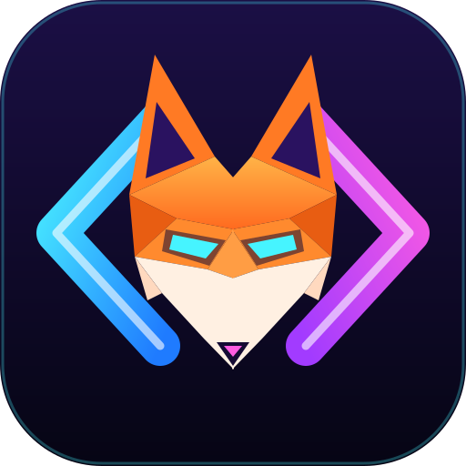

# XmlCraft app icon

**Idea:** the angle brackets of a tag, as neon tubes, with a fox between them: sharp, quick and hard to fool, like a good validator. The ears of the fox touch the brackets, so the animal and the markup are one mark.

**Palette:** a dark indigo tile (`#1B0F45` to `#060514`), neon cyan to blue (`#4AF2FF` to `#1F7BFF`) and magenta to violet (`#FF5CE1` to `#A23BFF`) for the brackets, fox orange (`#FFB347` to `#E85D12`), cream (`#FFF0E2`) and a cyan visor for the eyes.

**Tile:** `viewBox="0 0 512 512"`, a rounded square with `rx=112`. Windows and Linux icons use the full-bleed tile. macOS icons put it on Apple's grid (an 824 px body centred on a transparent 1024 px canvas). The shapes are flat polygons, strokes and gradients only (no filters), so the same file is drawn by the app (About, Home) and reads down to 16 px.

**Provenance:** an original mark composed with AI assistance at the project owner's direction; no third-party artwork, nothing from any Altova product. Licence: [LICENSE.txt](LICENSE.txt) (`MIT OR Apache-2.0`, like the repo).

## Files

| File | What it is |
|---|---|
| `xmlcraft.svg` | Master vector; every other file is rendered from it with `packaging/icons.sh` |
| `xmlcraft-1024.png` | macOS grid, also the runtime Dock icon |
| `xmlcraft.icns` | macOS app icon |
| `xmlcraft.ico` | Windows app icon, 16 to 256 px |
| `hicolor/<size>/apps/io.github.thorstenhirsch.xmlcraft.png` | Linux icon theme, 16 to 512 px |
| `hicolor/scalable/apps/io.github.thorstenhirsch.xmlcraft.svg` | Linux scalable icon |
